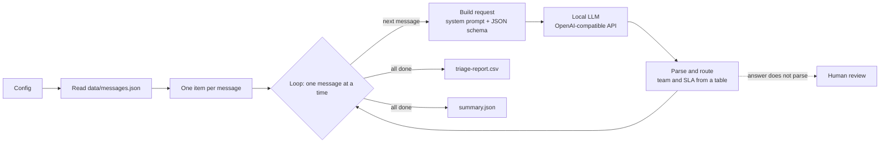

# Support triage with a local LLM (n8n)

An [n8n](https://n8n.io) workflow that reads support messages from customers, couriers and partner restaurants of a
food-delivery app, classifies each one with a **language model running on the same machine**, and routes it to a team with
an SLA. No message leaves the computer: the model is served by [LM Studio](https://lmstudio.ai) through its
OpenAI-compatible API.

The messages in [`data/messages.json`](data/messages.json) are fictitious, written in Brazilian Portuguese.

## How it works



For each message the model returns `category`, `urgency`, `sentiment`, a `summary` and a `suggested_reply`. Then:

| Category | Team | SLA |
|---|---|---|
| `late_order` | Delivery operations | 0.5 h |
| `missing_or_wrong_item` | Order support | 4 h |
| `billing_refund` | Payments | 4 h |
| `app_issue` | Product and engineering | 24 h |
| `courier_account_payout` | Courier support | 24 h |
| `restaurant_partner` | Partner success | 24 h |
| `praise` | Customer experience | 72 h |
| `other` | Customer service | 24 h |
| *invalid answer* | **Human review** | 4 h |

### Design decisions

- **The model classifies; the code routes.** The team and the SLA come from the table above, in the `Parse and route`
  node. A model cannot send a ticket to a team that does not exist or invent an SLA.
- **Structured output.** The request carries a JSON schema (`response_format: json_schema`, `strict: true`) with the
  allowed categories as an `enum`, so the server constrains the answer to that shape.
- **Distrust the answer anyway.** The parser strips a `<think>` block (reasoning models may add one), parses the JSON and
  checks the category against the table. Anything that fails goes to **Human review** instead of being guessed.
- **The suggested reply is a draft.** The prompt forbids promising a refund or a deadline that a person has not
  approved.
- **One message per iteration.** A *Loop Over Items* node sends one request at a time, so the latency in the report is
  the latency of that message alone.

## Run it

You need [Docker](https://www.docker.com) and [LM Studio](https://lmstudio.ai) with the `qwen/qwen3.5-9b` model
(6.55 GB on disk, 6.1 GiB in memory once loaded).

1. Start the model server on LM Studio's default port and load the model:

   ```sh
   lms server start --port 1234
   lms load qwen/qwen3.5-9b --context-length 4096 -y
   ```

2. Import and run the workflow (it checks that the server answers first):

   ```sh
   ./run.sh          # macOS, Linux, Git Bash
   ```

   ```powershell
   .\run.ps1         # Windows PowerShell
   ```

3. Read the results in `data/output/triage-report.csv` and `data/output/summary.json`.

The settings are in the workflow's `Config` node:

| Field | Default | What it does |
|---|---|---|
| `llmBaseUrl` | `http://host.docker.internal:1234/v1` | OpenAI-compatible server, seen from inside the container |
| `model` | `qwen/qwen3.5-9b` | Model name sent in the request |
| `maxTokens` | `600` | Maximum tokens per answer |
| `maxMessages` | `8` | How many messages to process; use 1 or 2 on a slow machine |
| `inputFile`, `reportFile`, `summaryFile` | under `/data` | The `./data` folder of this repository, mounted in the container |

To open the workflow in the n8n editor instead, run `docker compose up` and go to <http://localhost:5678>; on the first
visit n8n asks you to create a local owner account. If you have not run the script, import
`workflow/support-triage.json` from the editor's menu.

Any other server that implements the OpenAI chat-completions API with `response_format: json_schema` should work by
changing `llmBaseUrl` and `model`; only LM Studio was tested.

## A real run

The files in [`examples/`](examples/) are the unedited output of `./run.sh` with all 8 messages, on 2026-10-29.

**Machine:** laptop with an Intel Core i5-1235U, Intel Iris Xe integrated graphics (no dedicated GPU) and 16 GB of RAM,
with about 1.8 GB free before the model was loaded. **Model:** `qwen/qwen3.5-9b` in LM Studio, context of 4096 tokens,
temperature 0.

| Message | Category | Urgency | Team | SLA | Seconds | Tokens |
|---|---|---|---|---|---:|---:|
| MSG-001 courier stopped, order 70 min late | `late_order` | medium | Delivery operations | 0.5 h | 78.4 | 435 |
| MSG-002 missing burger, cold fries | `missing_or_wrong_item` | medium | Order support | 4 h | 61.0 | 414 |
| MSG-003 charged twice | `billing_refund` | high | Payments | 4 h | 73.1 | 407 |
| MSG-004 courier payout not received | `courier_account_payout` | medium | Courier support | 24 h | 75.6 | 412 |
| MSG-005 restaurant menu shows old prices | `restaurant_partner` | medium | Partner success | 24 h | 83.2 | 405 |
| MSG-006 app crashes when applying a coupon | `app_issue` | medium | Product and engineering | 24 h | 143.4 | 420 |
| MSG-007 compliment to the courier | `praise` | low | Customer experience | 72 h | 112.0 | 394 |
| MSG-008 customer asks if the app delivers in their city | `restaurant_partner` | low | Partner success | 24 h | 119.3 | 383 |

- **Latency:** 746 s of model time for the 8 messages, **93.3 s per message on average** (61 s to 143 s). The whole
  `run.sh`, with the container start and the import, took 823 s. This is CPU inference on a machine short of memory: it
  shows the workflow works, not how fast a 9B model can be.
- **Valid answers:** all 8 parsed and matched the schema; none went to Human review.
- **Read by hand, two answers are wrong:**
  - MSG-008 is a customer asking whether the app delivers in their city, and the model routed it to the restaurant team
    (`restaurant_partner`) instead of `other`.
  - MSG-001 is an order in progress with the courier stopped for 40 minutes; the prompt defines that as `high`, and the
    model answered `medium`.

  Both answers are valid JSON with an allowed category, so no rule can catch them. That is what an evaluation set is for:
  the next step is a labeled set of messages and the accuracy per category, before trusting the routing.
- **Suggested replies:** none of the 8 promises a refund or a deadline. They are drafts for an agent to edit.

No time savings are claimed: measuring them would need a real support queue and the time agents spend today.

## Repository layout

```
workflow/support-triage.json   the n8n workflow
data/messages.json             8 fictitious support messages
data/output/                   created by each run (git-ignored)
examples/                      output of the run described above
docker-compose.yml             n8n 2.45.6, with ./data mounted at /data
run.sh, run.ps1                import + execute from the command line
```

## License

[MIT](LICENSE)
